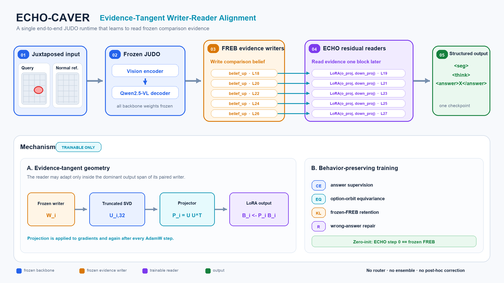

# [Research] ECHO-CAVER: Evidence-Tangent Residual Readers for FREB-CAVER

> Evidence-tangent Causal Hidden-state Orthogonal residual-reader LoRA for
> industrial anomaly reasoning with JUDO and FREB-CAVER.

ECHO-CAVER is a parameter-efficient extension of
[FREB-CAVER](https://github.com/choi0312/FREB-CAVER) on the public
[JUDO](https://github.com/woodavid31/JUDO) model. It freezes both JUDO and the
FREB visual-evidence carrier, then installs rank-16 residual readers directly
after FREB's five evidence-writing decoder layers. The LoRA output directions
are constrained to the rank-32 singular span of the corresponding frozen FREB
writer. The resulting system remains one end-to-end checkpoint/runtime: no
router, threshold, ensemble, crop policy, or post-hoc answer correction is used.



## Result at a glance

| Model | AD | DC | DL | DD | DA | OC | OA | Overall |
|---|---:|---:|---:|---:|---:|---:|---:|---:|
| [JUDO (paper)](https://arxiv.org/abs/2605.20284) | 65.04 | 74.74 | 73.01 | 84.56 | 89.41 | 94.04 | 87.58 | 81.20 |
| [AD-Copilot (paper)](https://arxiv.org/abs/2603.13779) | 73.64 | 67.89 | 64.08 | 80.60 | 85.91 | 91.06 | 87.78 | 78.71 |
| [AD-Copilot-Thinking (paper)](https://arxiv.org/abs/2603.13779) | **73.95** | 74.29 | **76.40** | 84.92 | 86.93 | 91.86 | 87.67 | 82.29 |
| **ECHO-CAVER v1 (this archive)** | 65.8231 | **76.7698** | 75.3531 | **86.1556** | **89.6094** | **95.1548** | **88.0521** | **82.4168** |

ECHO is numerically **+1.2168 points over JUDO** and **+0.1268 points over
AD-Copilot-Thinking** in Overall. JUDO and AD-Copilot values are their
paper-reported standard 1-shot results; ECHO is this archive's strict
39,670-row, normalized 28-cell census. Because the external rows were not
re-scored with ECHO's exact parser, these are descriptive cross-paper
comparisons, not paired significance estimates.

As a separate internal validation, the 5,600-row component-disjoint paired
panel compares ECHO with its frozen FREB parent: 81.0758 versus 80.8060
(+0.2698 points), with component-cluster 95% CI `[-0.0937, +0.6317]` and exact
McNemar `p=0.13321`. The clean result is positive but not significant.

The full-census result is not an independent generalization estimate. It
contains benchmark-targeted/training-overlap components. The clean panel is
therefore the stronger generalization check, and it does not establish a
statistically conclusive gain. See [CLAIMS.md](CLAIMS.md) before citing a
number.

## Core contribution

FREB writes comparison evidence into decoder layers `18, 20, 22, 24, 26`.
ECHO places readers at `19, 21, 23, 25, 27`, targeting `o_proj` and
`down_proj`. For writer matrix `W_i`, ECHO computes its leading left-singular
basis `U_i` and constrains every LoRA-B update to

```text
B_i <- U_i U_i^T B_i,    rank(U_i) = 32.
```

The constraint is applied to gradients and again after every AdamW step.
Unlike continual-learning orthogonal LoRA, ECHO learns *inside* the established
visual-evidence span. Zero initialization gives exact FREB identity before the
first update (`max_abs_error = 0.0`).

## Repository map

| Path | Contents |
|---|---|
| `paper/` | arXiv-oriented LaTeX source and rendered research paper |
| `src/` | exact training, inference, manifest, and scoring programs |
| `checkpoints/` | 9.1MB ECHO v1 PEFT adapter |
| `results/` | clean-panel and full-census machine-readable results |
| `artifacts/training/` | frozen training summary and mechanics receipt |
| `recipes/` | exact H200 screening and full-evaluation launch recipes |
| `reports/` | chronological experiment ledger |
| `scripts/verify_archive.py` | checksum, score, and identity verifier |

## Quick integrity check

```bash
python3 scripts/verify_archive.py
python3 -m unittest discover -s tests -v
```

The verifier does not require JUDO, MMAD, a GPU, or network access. Full model
reproduction requires separately accepting the JUDO, FREB-CAVER, and MMAD
terms; follow [REPRODUCIBILITY.md](REPRODUCIBILITY.md).

`ARCHIVE_MANIFEST.sha256` seals every committed research artifact other than
the manifest itself. The verifier checks all entries before reporting success.

## Paper and documentation

- [Research paper](paper/ECHO_CAVER_research_archive.pdf)
- [Method specification](METHOD.md)
- [Results and statistics](RESULTS.md)
- [Reproducibility protocol](REPRODUCIBILITY.md)
- [Claim boundaries](CLAIMS.md)
- [Korean summary](README.ko.md)

## Status

This is a private research archive, not a production anomaly-detection system
or an accepted publication. ECHO-CAVER v1 is retained as a full-benchmark
candidate because it crosses 82% on the full census; further asset-disjoint
replication is required before a generalization claim.
